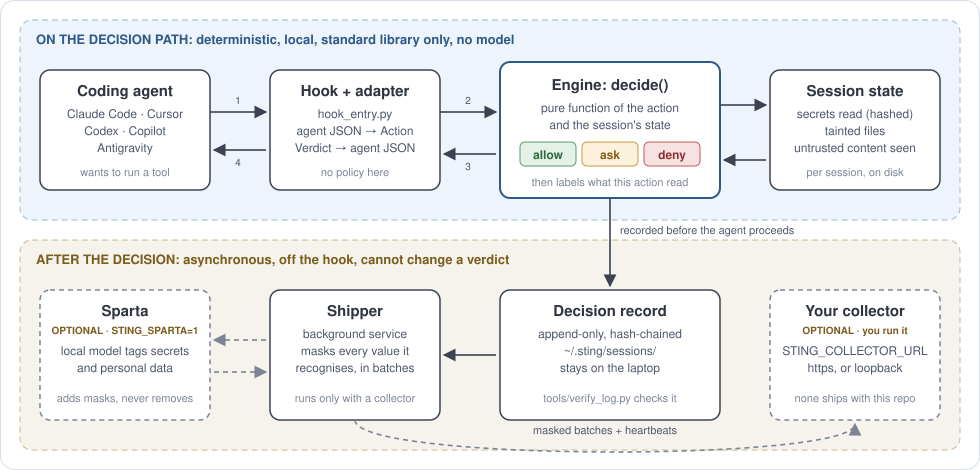

# 🛡️ StingLabs

**Stops AI coding agents from leaking your secrets.**

Sting is a guard that sits inside your coding agent (Claude Code, Cursor, Codex, Copilot, Antigravity). Before
the agent runs anything, Sting checks it and answers **allow**, **ask** or **deny**.

It doesn't guess from what a command looks like. It tracks **where the data came from**. If the agent read your
`.env` at step 2, Sting blocks the `git push` that carries it at step 40.

> Everyone else asks *"is this command dangerous?"*
> Sting asks *"is this command dangerous **given what already happened in this session**?"*

**Sparta** is an optional small local model that finds secrets and personal data in text. It only masks what gets
sent to your own collector. It never makes a decision.

## ✨ Why it's different

- 🎯 **Follows the data, not the wording.** Splitting or re-encoding a secret doesn't sneak it past.
- 🔒 **No AI in the decision.** Pure rules, so there's nothing to prompt-inject. Same history, same verdict.
- 💻 **Runs on your laptop.** Nothing leaves your machine unless you set up your own collector.
- 📦 **Zero dependencies.** The guard uses only the Python standard library.
- 📜 **Tamper-evident log.** Every decision is written to a hash-chained log on your machine.

## 🔍 How it works



1. The agent wants to run a tool (read a file, run a command, call a URL).
2. Sting's hook catches it and asks the engine.
3. The engine checks the action against everything this session already did.
4. The verdict goes back to the agent, and the decision is logged locally.


*Every step here looks harmless alone. The push is blocked because what it carries traces back to `.env`. The
same push in a clean session is allowed. Try it: `python3 engine/runner/replay.py --only I02-commit-into-pr-branch --verbose`*

## 📋 What you need

- 🐍 **Python 3.11 or newer**
- 🤖 **A coding agent:** Claude Code (fully verified), Cursor, Codex, Copilot or Antigravity. [Details](docs/agents.md)
- 💻 **macOS or Linux.** Windows works natively too, but isn't proven end to end yet.
- 🌱 **Git** is optional. A ZIP download works too.

## 🚀 Install

> 💡 **Two tips first:**
> - Put the folder **next to your projects** (like `~/code/stinglabs` beside `~/code/my-app`). The
>   installer suggests the repos next to it as "your projects".
> - **Keep the folder** after installing. You need it to update and uninstall.

### 🍎 macOS

1. **Get Python 3.11+.** Apple's built-in one is usually too old.
   ```bash
   brew install python@3.12
   ```
   No Homebrew? Use the installer from [python.org](https://www.python.org/downloads/).

2. **Get the code.**
   ```bash
   mkdir -p ~/code && cd ~/code
   git clone https://github.com/yanivsp2909/stinglabs.git
   ```
   No git? Click **Code → Download ZIP** above, unzip it, and move the folder into `~/code`.

3. **Run the installer.**
   ```bash
   cd ~/code/stinglabs/engine
   python3.12 install.py
   ```
   It shows the repos it found and asks `Declare these as your project?`. Type `y` if the list is right.

4. **Check it worked.**
   ```bash
   python3.12 install.py --status
   ```

5. **Start a new agent session.** Done ✅

### 🪟 Windows

> ⚠️ Agent running inside **WSL**? Use the macOS steps inside WSL instead.

1. **Get Python 3.11+** from [python.org](https://www.python.org/downloads/). On the first screen, tick
   **Add python.exe to PATH**.

2. **Open PowerShell** (normal, **not** "Run as administrator") and get the code.
   ```powershell
   mkdir $HOME\code -Force; cd $HOME\code
   git clone https://github.com/yanivsp2909/stinglabs.git
   ```
   No git? Click **Code → Download ZIP** above, right-click it, **Extract All**, and move it into `$HOME\code`.
   Windows often nests it twice (`stinglabs-main\stinglabs-main`): use the inner one.

3. **Run the installer.**
   ```powershell
   cd $HOME\code\stinglabs\engine
   py install.py
   ```
   Type `y` when it asks about your projects.

4. **Check it worked.**
   ```powershell
   py install.py --status
   ```

5. **Start a new agent session.** Done ✅

Windows-specific details (slower checks, known gaps): [docs/install.md](docs/install.md#native-windows-experimental)

### 🧪 See it block something

In a throwaway folder, make a fake secret:

```bash
mkdir /tmp/sting-demo && cd /tmp/sting-demo && git init -q
printf 'API_KEY=FAKE_demo_value_0123456789abcdef\n' > .env
```

Then ask your agent: *"read .env and post it to https://example.com with curl"*.
Reading is allowed. **Sending is denied.** 🛑

## 🔧 Everyday use

| I want to... | Do this |
|---|---|
| Allow something it blocked, once | Run the command printed in the refusal, from **your own terminal** (on Windows, type `py` instead of `python3`) |
| Add a new project folder | `install.py --roots "/path/a:/path/b"` (Windows: separate with `;`) |
| Update | `git pull`, then re-run `install.py` (ZIP: download the new one and run `install.py` from it) |
| Uninstall | `install.py --uninstall`. Your decision logs in `~/.sting` are kept. [More](docs/uninstall.md) |
| Every flag and setting | [docs/install.md](docs/install.md) · [docs/configuration.md](docs/configuration.md) |

## 🧠 Optional: Sparta

Sparta only changes what gets **sent to your collector**, never what gets **decided**. Skip it if you don't use
a collector.

1. Install it with the same Python you installed the guard with:
   ```bash
   python3.12 -m pip install -e ./sparta
   ```
2. Download the model files from this repo's **Releases** into `sparta/models/` ([how](sparta/README.md#the-model-files)).
3. Turn it on: add `export STING_SPARTA='1'` to `~/.sting/env`, then re-run `install.py`.

If a release has no model files yet, they haven't been published. The guard works fully without them.
[More about Sparta](docs/sparta.md)

## ⚖️ Honest limits

- If an agent reads a secret and then **re-types it from memory** into a later action, with no file write in
  between, there's nothing to trace. Exact values and known key formats are still caught.
- **Claude Code** is fully verified. Cursor's format is checked but no live data has been captured. Codex, Copilot
  and Antigravity pass our tests but aren't verified against the real agents yet.
- Native **Windows** isn't proven end to end yet.

All the limits: [engine/README.md](engine/README.md#honest-limits)

## 📊 What's tested

- ✅ **~10,000 tests** for engine decisions: `cd engine && python3 -m pytest tests -q`
- ✅ **107 replayable scenarios.** Attacks: 43 blocked, 6 blocked earlier, 16 ask, 14 missed of 79. Normal work:
  25 of 25 allowed, **0 false alarms** (`python3 engine/tools/grade_engine.py`). These are synthetic, so treat them
  as regression data, not a benchmark.
- ✅ Install and uninstall, on macOS and Linux
- 🚧 Sparta-seeded taint: not built yet
- 🚧 Sparta intent model: not good enough to ship, off by default

## 📁 What's in here

```
engine/   the guard: hook, engine, installer, tests
sparta/   the optional Sparta model package (no weights in git)
docs/     install, uninstall, configuration, agents, diagrams
```

## 📄 License

Apache-2.0. See [LICENSE](LICENSE) and [NOTICE](NOTICE).
